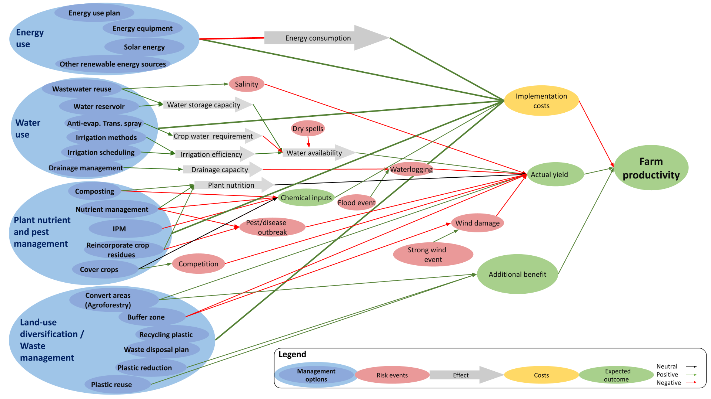
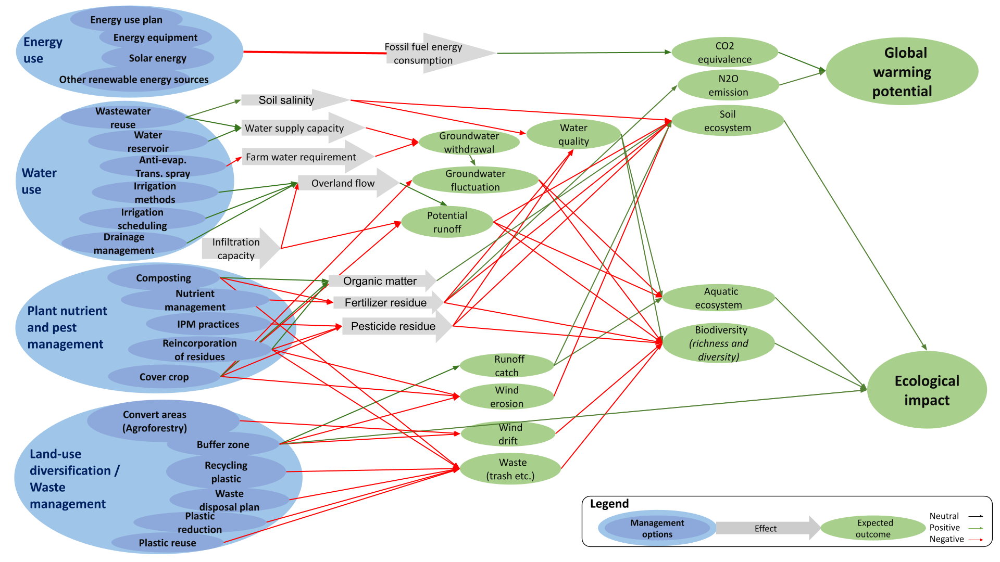

```{r setup, include=FALSE}
knitr::opts_chunk$set(echo = FALSE, warning = FALSE, message = FALSE)
library(tidyverse)
```

## The core question

> *"We know many things might help — but which ones should we actually do?"*

- Banana production faces climate risks: drought, storms, salinity, pests
- Many certification measures exist — 21 were evaluated across 5 groups
- Resources are limited; outcomes are uncertain; objectives are multiple
- **Goal:** prioritize measures by their expected impact on adaptation, mitigation, and ecology

## Why uncertainty matters

- We rarely have precise knowledge of how an intervention will perform
- A single "best guess" hides the full range of what could happen
- **What we believe** is a range, not a number
  - e.g. baseline banana yield: 20,000 – 60,000 kg/ha/yr
- Decision analysis embraces uncertainty rather than hiding it

## The decision analysis framework

```{r fig2, out.width="85%"}
knitr::include_graphics("../Manuscript/22_Resubmission/Figure_2_revised.png")
```

*From knowledge to quantified impact assessment — Fernandez et al. (2022)*

## The system: banana production

```{r fig1, out.width="90%"}
knitr::include_graphics("../Manuscript/22_Resubmission/Figure_1.png")
```

*The banana production system and its environmental flows*

## The decision: which certification measures?

21 interventions were evaluated, organized into **5 groups**:

| Group | Examples |
|---|---|
| 1. Land-use diversification | Buffer zones, conversion of unproductive land |
| 2. Energy use | Energy use plan, solar energy, biomass |
| 3. Water use | Wastewater reuse, water reservoir, irrigation scheduling |
| 4. Plant nutrient & pest management | Composting, IPM, cover crops |
| 5. Waste management | Recycling plastic, plastic reduction, plastic reuse |

## From measures to outcomes

```{r fig3, out.width="90%"}
knitr::include_graphics("../Manuscript/22_Resubmission/Figure_3.png")
```

*Five measure groups → intermediate effects → three outcome categories*

## The impact pathway: one measure

```{r fig4, out.width="90%"}
knitr::include_graphics("../Manuscript/22_Resubmission/Figure_4.png")
```

*A farm management intervention can have positive, negative, and neutral effects*

## Detailed pathway: adaptation (Figure S1)

```{r figS1, out.width="100%"}

```

## Detailed pathway: mitigation & ecology (Figure S2)

```{r figS2, out.width="100%"}

```

## Expert elicitation: where numbers come from

- We interviewed experts and searched the literature for each variable
- Values are expressed as **90% confidence intervals** — not point estimates
- Experts provide their range of belief: *"I am 90% sure the value falls between X and Y"*

```{r input_snippet, echo=FALSE}
inputs <- read_csv("certification_measures_input_table.csv", show_col_types = FALSE)
inputs <- dplyr::filter(inputs, !is.na(label))
inputs <- inputs[, c(3, 5, 7, 2)]
knitr::kable(inputs[c(2, 8, 9, 14, 15), ],
             col.names = c("Variable", "Lower", "Upper", "Label"),
             digits = 3,
             caption = "Example input estimates (90% confidence intervals)")
```

## The input table

- One row per variable; columns: `variable`, `distribution`, `lower`, `upper`
- Distribution types:
  - `posnorm` — positive normal (e.g. yield, price)
  - `tnorm_0_1` — truncated normal between 0 and 1 (e.g. proportions, risks)
  - `const` — fixed value (e.g. number of simulation years = 10)
- **Your project needs a table like this** — it is the formal representation of what you know

## Monte Carlo simulation

- Draw randomly from each input distribution ~10,000 times
- Each draw = one plausible "version of the world"
- Run the model function for every draw
- Output = a **distribution** of possible outcomes, not a single number

```r
certification_measures_simulation <- mcSimulation(
  estimate = estimate_read_csv("certification_measures_input_table.csv"),
  model_function = certification_measures_function,
  numberOfModelRuns = 1e4,
  functionSyntax = "plainNames"
)
```

## The model function: logic in code

```r
certification_impact <- function(base_yield, base_market_price, base_cost,
                                 cost_measure, yield_benefit,
                                 event_risk, normal_damage,
                                 reduction_damage_measure, ...) {

  # simulate whether a risk event (e.g. storm) occurs each year
  event_years <- chance_event(event_risk, n = n_years)

  # yield without the measure vs. with the measure
  yield_no_measure <- ifelse(event_years, 1 - normal_damage, 1)
  yield_measure    <- ifelse(event_years, 1 - (normal_damage *
                               (1 - reduction_damage_measure)), 1)

  # net yield benefit from risk reduction
  yield_positive_impact <- mean(yield_measure - yield_no_measure)

  # ... repeat for negative risk, then compute costs, ecology, etc.
  return(list(yield = ..., cost = ..., adaptation = ...,
              mitigation = ..., ecology = ...))
}
```

## Key R functions you will use

| Function | Purpose |
|---|---|
| `mcSimulation()` | Run the Monte Carlo simulation |
| `estimate_read_csv()` | Read the input table |
| `chance_event()` | Simulate whether a risky event occurs |
| `vv()` | Add year-to-year variability around a value |
| `plot_distributions()` | Visualize simulation outputs |

All from the `decisionSupport` package:

```r
install.packages("decisionSupport")
library(decisionSupport)
```

## Results: prioritization across all measures

```{r fig5, out.width="85%"}
knitr::include_graphics("../Manuscript/22_Resubmission/Figure_5_revised.png")
```

## Reading the results

- **Colour** = direction of median effect (teal = positive, red = negative, grey = not assessed)
- **Dot size** = uncertainty (interquartile range — larger dot = wider spread)
- **Key finding:** no single measure dominates across all outcomes
- Trade-offs are real — the "best" choice depends on what your decision-maker values most

## Translating this to your own project

Your decision is already defined — that is the hard part

**Next steps before Friday:**

1. **Sketch your impact pathway** — boxes and arrows on paper
   - Decision → intermediate variables → outcomes
2. **List your variables** — what do you need to know to calculate outcomes?
3. **Assign ranges** — lower/upper 90% confidence interval for each
4. **Think about risks** — what binary events could occur? (use `chance_event`)

**Useful resources:** `github.com/CWWhitney/Certification_Prioritization`

## What makes a good model function

- Reflect your **causal understanding**, not just statistical associations
- Use `chance_event()` wherever a discrete risk exists (flood, pest outbreak, policy change)
- Use `vv()` to represent year-to-year variability in continuous quantities
- **Start simple** — a working two-variable model is better than an elaborate broken one
- Make it readable — collaborators should be able to follow the logic

## R and RStudio: set up before Friday

**Install software:**

- R: `https://cran.r-project.org`
- RStudio: `https://posit.co/download/rstudio-desktop`

**Install the package:**

```r
install.packages("decisionSupport")
```

**Clone/download the example repo:**

`github.com/CWWhitney/Certification_Prioritization`

Open `Certification_Prioritization.Rproj` and explore `R/certification_impact.R`

## Summary

| Step | What we did | What you will do |
|---|---|---|
| 1. Define decision | Which certification measure to adopt? | Your own intervention question |
| 2. Impact pathway | Diagrams (Figures 3 & 4) | Sketch on paper this week |
| 3. Input table | 90% CI for ~130 variables | Build yours before programming |
| 4. Model function | `certification_impact()` in R | Write yours starting Friday |
| 5. Simulate | `mcSimulation()` × 10,000 | Same tool, your function |
| 6. Prioritize | Figure 5 bubble plot | Your results |

*Fernandez, E., Do, H., Luedeling, E., Luu, T.T.G., Whitney, C. (2022). Agronomy for Sustainable Development.*
